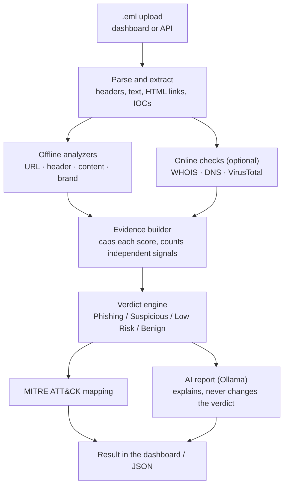

# Phishing Email Analyzer

A local tool that analyses a `.eml` file and tells you whether it is phishing, and why.
It checks the headers, links, wording and sender, optionally looks up WHOIS, DNS and
VirusTotal, and has a small local LLM (Qwen3 4B via Ollama) write a plain-English report.

The main design rule: **rules decide the verdict, the LLM only explains it.** The score
comes from deterministic checks, so the same email always gets the same result and the
model can't invent a verdict.

## How it works



| Score | Verdict |
| --- | --- |
| 70-100 | Phishing |
| 45-69 | Suspicious |
| 20-44 | Low Risk |
| 0-19 | Benign |

A few rules that shaped the scoring:

- Each component (URL, header, content, brand, WHOIS, DNS, VirusTotal) is capped, so one
  area can't decide the verdict alone.
- The URL score is the worst link plus a small bonus, not a sum. A newsletter with 80
  harmless links stays low.
- A lookup that fails (timeout, quota, no API key) counts as **unknown**: it adds no risk and
  is never reported as clean.
- When three or more independent signals agree, the score is raised to at least 70.
- A sender name or subject that claims a brand the sender doesn't own (e.g. "Binance"
  from an unrelated domain) is at least Suspicious on its own.
- Failed SPF/DKIM/DMARC alone stays Low Risk (forwarded mail fails too), but together with
  another real finding it becomes Suspicious.

More detail in [docs/design-decisions.md](docs/design-decisions.md).

## Results

Measured with online checks off, so the numbers come from the offline rules only.
"Flagged" means a Phishing or Suspicious verdict.

| Test set | Emails | Accuracy | Precision | Recall | False-positive rate |
| --- | --- | --- | --- | --- | --- |
| **Fresh set** (never used for tuning): Phishing Pot + Apache lists | 300 + 300 | 72.5% | 99.3% | 45.3% | 0.3% |
| 2026 set: newest Phishing Pot + Apache lists | 300 + 300 | 87.2% | 100% | 74.3% | 0.0% |
| Held-out set: Phishing Pot + SpamAssassin ham | 200 + 200 | 73.5% | 95.2% | 49.5% | 2.5% |

The fresh set is the honest number: it was built after the last rule change and run once.
The other two sets had been looked at before, so treat them as supporting results. Counting
anything above Benign as flagged, recall on the fresh set is 75.7% with a 2.0% false-positive
rate. Method, caveats and how to reproduce: [docs/evaluation.md](docs/evaluation.md).

**With WHOIS, DNS and VirusTotal on**, the 2026 set reaches 85.3% recall (up from 74.3%
offline) with 99.2% precision. Two legitimate emails were flagged; one of them turned out to be
a real voicemail-phishing email that had been posted to the Apache announce list, so the only
true false positive was a news link that three VirusTotal vendors flag.

## Quick start

Requirements: Python 3.10+, and [Ollama](https://ollama.com) if you want the AI report.

```bash
cd backend
python -m venv venv
venv\Scripts\activate            # Windows  (macOS/Linux: source venv/bin/activate)
pip install -r requirements.txt
copy .env.example .env           # macOS/Linux: cp .env.example .env

ollama pull qwen3:4b             # optional, for the AI report
uvicorn app.main:app --reload
```

Open http://127.0.0.1:8000/dashboard and drop in one of the files from `samples/`.

To use VirusTotal, put your key in `backend/.env` as `VIRUSTOTAL_API_KEY`. The free tier
allows 4 lookups a minute; requests are paced automatically. If Ollama runs out of memory on
a small GPU, set `OLLAMA_NUM_GPU=0` in `.env` or start it with `scripts/start_ollama_cpu.ps1`.

## API

| Method | Path | Purpose |
| --- | --- | --- |
| POST | `/analyze-email` | Analyse one `.eml` (multipart field `file`) |
| POST | `/analyze-batch` | Analyse up to 50 files with optional labels |
| GET / POST | `/evaluation-results` | Read or save batch evaluation results |
| GET | `/llm-health` | Is Ollama reachable and the model installed? |
| GET | `/lookup-status` | Which online checks are on |
| GET | `/dashboard` | Web dashboard |

Interactive docs are at http://127.0.0.1:8000/docs.

## Tests and evaluation

```bash
cd backend
python -m pytest                                   # unit and API tests, no network needed
python -m tests.evaluate_dataset --dataset ../datasets/public_2026 --offline
```

The evaluation script expects `phishing/` and `benign/` subfolders of `.eml` files.
`scripts/mbox_to_eml.py` splits mbox archives into that format.

## Project structure

```
backend/
  app/
    api/            FastAPI routes (analysis, dashboard, batch evaluation)
    llm/            Ollama client, prompt and report parsing
    services/       parser, URL extraction, evidence builder, verdict engine
      analyzers/    header, content, brand, URL, WHOIS, DNS, VirusTotal, MITRE
    static/         dashboard JavaScript and CSS
    templates/      dashboard HTML
  scripts/          Ollama CPU start scripts, mbox splitter
  tests/            pytest suite and the evaluation script
docs/               design notes and evaluation details
samples/            a few example emails to try
```

## Limitations

- Recall is around 45% on mixed phishing. Of the 164 misses on the fresh set, 52 triggered
  no rule at all (often image-only or non-English) and the rest had only weak findings or a
  single signal.
- All legitimate test mail is mailing-list or 2002-03 mail; newsletters, receipts and bank
  notices are not covered, so real-world false positives may be higher.
- The legitimate test mail has no failed SPF/DKIM/DMARC results, so the new authentication
  rule is not yet tested against legitimate mail that fails them (forwarded mail, for example).
- The VirusTotal cache and rate limiter live in memory, so they reset on restart.
- Attachments are not opened or scanned.

## Data and credits

Evaluation data is not included in this repository. It comes from
[Phishing Pot](https://github.com/rf-peixoto/phishing_pot) (CC BY-NC 4.0), the
[Apache mailing-list archives](https://lists.apache.org/) and the
[SpamAssassin public corpus](https://spamassassin.apache.org/old/publiccorpus/).
Three samples in `samples/` are from Phishing Pot; see [samples/README.md](samples/README.md).

## License

MIT, see [LICENSE](LICENSE).
